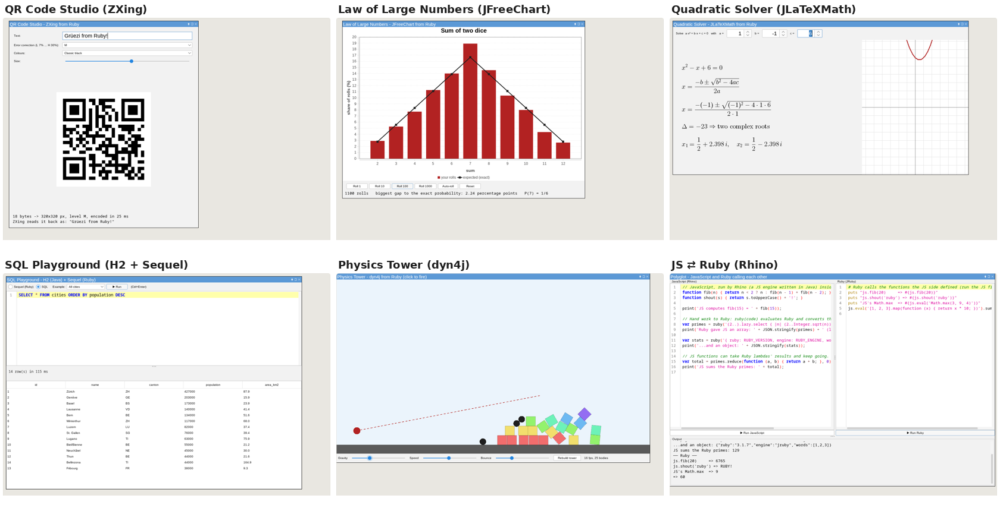

# JRuby in the browser with CheerpJ

Run the **unmodified** `jruby-complete-9.4.15.0.jar` from Maven Central (Ruby 3.1) in a web page, on
[CheerpJ](https://cheerpj.com/) 4.3, a JVM written in WebAssembly/JS that loads from Leaning
Technologies' CDN. You get:

- **A Ruby REPL page,** plus `jruby.js`, a small module you can drop into your own page.
- **Java GUIs in the page:** Swing/AWT windows, Processing sketches and Glimmer DSL for Swing.
- **A Ruby IDE and six demos.** Each is a single Ruby file that drives a Java library: QR codes,
  charts, LaTeX formulas, an SQL database, 2D physics, and JavaScript ⇄ Ruby.



## Quick start

```sh
git clone https://github.com/Largo/jruby-cheerpj.git && cd jruby-cheerpj
./run.sh            # fetch + verify everything into jars/, then serve http://127.0.0.1:8017/ (PORT=... to change)
./run.sh test       # headless Playwright test of the REPL page (own server on a free 127.0.0.1 port)
./run.sh test-demos # clicks and types through every demo
./run.sh prepare    # only fetch + build jars/
```

**Requirements:**
- `sh`, `curl`, `python3`
- A JDK 17 or newer, to compile the two small overlay patches and to run `gem install` with the JRuby
  jar when packing the Glimmer and Sequel gems.
- For the tests: Node.js with the `playwright` package and its Chromium (`NODE_PATH=$(npm root -g)` is
  used by default).

On a remote box, tunnel it with `ssh -L 8017:127.0.0.1:8017 <host>` and open http://localhost:8017/.
The server binds to 127.0.0.1 only.

### Nothing third-party is committed

`jars/` is git-ignored. `./run.sh prepare` fills it:

| What | Where it comes from |
|---|---|
| JRuby, Processing, RSyntaxTextArea, FlatLaf, ZXing, JFreeChart, H2, dyn4j, Rhino, JLaTeXMath | Maven Central, checked against Maven's `.sha1` (JRuby also `.sha256`) |
| `cheerpj-patch.jar` | compiled from `patch/src/` (about 40 lines that replace one JRuby class) |
| `processing-cheerpj-patch.jar` | Processing's own `-sources.jar` from Maven Central, patched by `patch/processing/build.sh` at build time |
| `glimmer-swing-gems.jar`, `sequel-gems.jar` | `gem install` from rubygems.org, packed by `patch/gems/build.sh` |
| CheerpJ runtime | always loaded by the page from `cjrtnc.leaningtech.com`; never downloaded or mirrored |

`run.sh` downloads `jars/jruby-complete-9.4.15.0.jar` from repo1.maven.org. It checks the jar against
the `.sha1` and `.sha256` files that Maven Central publishes next to it, then starts `serve.py`.
`serve.py` is a stdlib-only Python server: 206/Content-Range, keep-alive, ETag and the right MIME types.
Plain `python3 -m http.server` does not work, because it ignores Range.

The page (`index.html`) has a textarea, Run, Ctrl+Enter (Cmd+Enter), Alt+Up/Down history, an output
pane, a boot progress bar with timing, and a collapsed JVM console. Query options: `?java=17|11|8`,
`?gems=1`, `?warmup=0`, `?preload=0`, `?jar=...`.

## Embed it in your own page

Copy `jruby.js` and the jar next to your page, and serve them with a server that supports Range.
The jar must be on the same origin.

```html
<script src="https://cjrtnc.leaningtech.com/4.3/loader.js"></script>
<script type="module">
  import { bootJRuby } from "./jruby.js";
  const ruby = await bootJRuby({ jar: "jars/jruby-complete-9.4.15.0.jar",
                                 onStatus: (msg, pct) => console.log(pct, msg) });
  const r = await ruby.eval('puts "hello"; [1,2,3].sum');
  // r = { ok: true, out: "hello\n", result: "=> 6", ms: 12 }
</script>
```

All evals share one runtime and `TOPLEVEL_BINDING`, so locals, methods, classes and requires persist.
`$stdout` and `$stderr` are captured for each eval. Calls are queued.

If you would rather not use `jruby.js`, these are the raw CheerpJ calls it makes:

```js
await cheerpjInit({ version: 17, javaProperties: ["jruby.compile.mode=OFF", "jruby.native.enabled=false"],
  natives: { Java_jdk_internal_misc_Unsafe_fullFence() {}, Java_jdk_internal_misc_Unsafe_loadFence() {},
             Java_jdk_internal_misc_Unsafe_storeFence() {} } });
const lib = await cheerpjRunLibrary("/app/jars/jruby-complete-9.4.15.0.jar");   // /app = server root
const cfg = await new (await lib.org.jruby.RubyInstanceConfig)();
await cfg.setDisableGems(true);
const rt = await (await lib.org.jruby.Ruby).newInstance(cfg);
console.log(await (await rt.evalScriptlet("RUBY_DESCRIPTION")).toString());
```

## Java windows: Swing and Processing

`index.html` passes a `display` element to `bootJRuby`, so `JFrame`, Swing and AWT windows render
into the "Java windows" area of the page. You can drag, resize and close them, and Ruby blocks
work as listeners. See `examples/swing.rb` (a click counter, a form, and a `JPanel` subclass that paints).

[Processing](https://processing.org) 4.5.7 core (LGPL-2.1, 1 MB, Maven Central) is on the page's classpath
by default, so you can write sketches as Ruby subclasses of `PApplet`. See `examples/processing.rb`
(animation, mouse painting, bouncing balls). A Ruby `draw` runs at about 20-25 fps. Processing's AWT
surface draws through `BufferStrategy`, which is broken in CheerpJ (an NPE and a blank window), so
`patch/processing/build.sh` builds `jars/processing-cheerpj-patch.jar` with `PSurfaceAWT.render()`
drawing straight to the canvas. `./run.sh prepare` fetches and builds both overlays (this needs a JDK).
You can pass other jars with `?cp=a.jar,b.jar`; `?cp=` turns Processing off.

[Glimmer DSL for Swing](https://github.com/AndyObtiva/glimmer-dsl-swing) 0.0.5 is on the classpath too.
`patch/glimmer/build.sh` installs it and its 9 pure-Ruby dependencies with the stock JRuby jar, then packs
them into `jars/glimmer-swing-gems.jar` (1.2 MB). It also extracts concurrent-ruby's Java extension
classes into that jar, because CheerpJ can't load a jar nested inside a jar. `require 'glimmer-cheerpj'`
adds the gems to `$LOAD_PATH` without RubyGems and takes about 5-8 s. See `examples/glimmer.rb`
(hello world, data binding, a temperature converter, shapes). **Glimmer DSL for SWT cannot work here:**
SWT is a thin layer over native GTK/Win32/Cocoa libraries, and a browser JVM can't load native code.
Tried: `Display.new` raises `UnsatisfiedLinkError`. Glimmer DSL for Swing has the same DSL style on
pure Swing. Component keywords are snake_case class names, e.g. `j_text_field`; `jbutton`, `jlabel` and
`jframe` also work in the short form. A Glimmer proxy's `.original` is the real Swing object.

Gotchas for Ruby code:
- Processing *fields* keep their Java names: `mouseX`, `pmouseX`, `frameCount`, `width`.
- The `mousePressed` field is shadowed by the `mousePressed()` event method, so use the event methods.
- JRuby cannot `super` into protected Java methods like `JPanel#paintComponent`.
- An exception in a Java callback, such as `draw` or a listener, goes to the JVM console, not to the REPL.

## Ruby IDE app (`?app=ide`)

http://127.0.0.1:8017/?app=ide opens a small IDE written in Ruby: `apps/ide.rb`, about 310 lines.
It uses [RSyntaxTextArea](https://github.com/bobbylight/RSyntaxTextArea) 3.6.3 (editor with Ruby
highlighting, folding and line numbers) and [FlatLaf](https://www.formdev.com/flatlaf/) 3.7.2 (light/dark
look-and-feel). Both come from Maven Central via `./run.sh prepare` and add 2.3 MB.

- **Running code:** ▶ Run or Ctrl+Enter evaluates the editor in `TOPLEVEL_BINDING`, so the IDE and the page
  REPL share methods, classes and variables. Code runs in a Ruby thread, and stdout/stderr stream into the
  output pane (stderr in red) with the result value and the run time.
- **Errors:** an exception highlights the failing line in red and its callers in orange.
- **Toolbar:** an example picker (Ruby basics, Java collections, a Swing window, a Processing sketch) and a
  dark-mode toggle that switches both FlatLaf and the editor theme.
- **Timing:** the app starts about 8 s after JRuby is ready, so about 23 s from a cold page load.
- **Reopening:** `RubyIDE.open` in the REPL reopens a closed IDE. `?app=NAME` runs any `apps/NAME.rb`
  after boot, with a large window area on top of the page.

## Demos (`?app=NAME`)

Each demo is one Ruby file in `apps/` that drives Java libraries from Maven Central. The page links
to all of them. `./run.sh test-demos` clicks and types through each one in headless Chromium.

| Demo | Open | Java library | What it shows |
|---|---|---|---|
| Ruby IDE | `?app=ide` | RSyntaxTextArea 3.6.3, FlatLaf 3.7.2 | See above |
| QR Code Studio | `?app=qr` | ZXing 3.5.4 (core + javase, 650 KB) | Live QR code as you type, error-correction levels, colours; ZXing decodes its own output |
| Law of Large Numbers | `?app=dice` | JFreeChart 1.5.6 (1.6 MB) | Ruby `tally` of dice rolls versus the exact `Rational` probabilities; Roll 1/10/100/1000 and auto-roll |
| Quadratic Solver | `?app=formula` | JLaTeXMath 1.0.7 (650 KB) + Java2D | Exact `Rational` and `Complex` roots, typeset formula with the substituted numbers, plotted parabola |
| SQL Playground | `?app=sql` | H2 2.5.252 (2.6 MB) + Sequel 5.109.0 gem | Sequel DSL (showing its generated SQL) or raw SQL over Swiss cities in memory, results in a sortable `JTable`; `DB` is shared with the REPL |
| Physics Tower | `?app=physics` | dyn4j 6.0.0 (500 KB) | Click to fire balls at a crate pyramid; gravity, speed and bounce sliders. Drawing runs at 13-20 fps; physics stays real-time |
| JS ⇄ Ruby | `?app=polyglot` | Rhino 1.9.1 (1.6 MB) | JavaScript calls `ruby("...")` and gets Ruby arrays/hashes back; Ruby calls `js.fib(20)`. Uses a Ruby subclass of Rhino's `BaseFunction` |

Starting a demo takes 5-13 s after JRuby is ready. The SQL demo is the slowest, because it loads Sequel
and H2. `./run.sh prepare` fetches all the jars and checks them against Maven Central's SHA-1 files.
The Sequel gem is packed into `jars/sequel-gems.jar` by `patch/gems/build.sh`, the same generic packer
that builds the Glimmer jar.

JRuby gotchas found while building the demos (and worked around in the code):
- **Setter shortcuts on `Graphics2D`:** `g.stroke = ...` and `g.transform` resolve to `SunGraphics2D`'s
  public fields or to the `transform(AffineTransform)` method. Use `setStroke`, `getTransform` and
  `setTransform` explicitly.
- **Checking whether a Java class exists:** `defined?(Java::Some::Class)` is nil until the class is
  first used, so rescue `NameError` instead.
- **Swing threads:** code called from the REPL runs off Swing's event thread. Demos that change a
  `JTable` or the physics world from outside hop onto it with `SwingUtilities.invoke_*`.
- **Non-ASCII input:** CheerpJ takes keys like ü and é from a real keyboard, but ignores text inserted by
  IMEs, emoji pickers and similar tools.

## Versions

| | |
|---|---|
| JRuby | 9.4.15.0 (Ruby 3.1.7), stock `jruby-complete` from Maven Central. sha1 `7563d4535ba18ed6294f5130e0feb4417b6d12df`, sha256 `e8a461c4...2639d2` |
| Java | CheerpJ Java 17 runtime (`17.0.19-internal`), the default and the fastest. Java 11 and Java 8 also pass the full test. |
| CheerpJ | 4.3, from `https://cjrtnc.leaningtech.com/4.3/loader.js` |
| Browser | tested in headless Chromium through Playwright 1.60 |

**JRuby 10 is not possible here.** JRuby 10 needs Java 21. CheerpJ 4.3 rejects `version: 21` with
"Unsupported Java version: 21". On Java 17, JRuby 10's classes (major version 65) fail with
`UnsupportedClassVersionError`. Downgrading the bytecode does not help either: JRuby 10 uses
`MatchException`, `SwitchBootstraps` and `Thread.ofVirtual`. See `docs/research/attempt-a-jruby10.md`.

## Sizes and timings (this box, cold cache, headless Chromium, Java 17)

- Page: `index.html` 8 KB and `jruby.js` 8 KB (about 3.5 KB each gzipped). The jar is 34.4 MB on
  disk, but CheerpJ reads only the parts it touches.
- Downloaded per cold boot:
  - about 13.3 MB from the CheerpJ CDN, in about 40 requests
  - about 14.2 MB of jar byte ranges, in about 87 requests
  - about 27.5 MB in total
- **Cold boot: 14-17 s** to "ready", depending on box load. It breaks down as:
  - `cheerpjInit` 0.6 s
  - `cheerpjRunLibrary` 3 s
  - class load 1.5 s
  - `Ruby.newInstance` 8-10 s
  - warm-up plus harness 2 s

  The boot is CPU-bound, not network-bound. A warm HTTP cache does not make it faster, because
  CheerpJ JIT-compiles everything again on every page load.
- **Evals:**
  - Trivial evals take about 5 ms.
  - The required snippet takes about 150-200 ms the first time and about 20 ms after that.
  - `require 'json'` takes about 1 s the first time.
  - `fib(20)` takes about 0.3 s and `fib(24)` about 1.3-1.7 s on a fresh runtime. In `./run.sh test`, `fib(24)`
    runs after a raised exception and takes about 6.3 s; see the stack-trace limitation below.
  - A 300k `times` loop takes about 2 s.

## Limitations

- **Interpreter only** (`jruby.compile.mode=OFF`). CheerpJ's `MutableCallSite` is broken
  (cheerpj-meta #205): with the JIT on, scripts die with `IllegalStateException: uninitialized call site`.
- **Speed depends on what runs first.** CheerpJ seems to specialise JRuby's interpreter on the first
  code it sees. With RubyGems off, `jruby.js` runs a 1.3 s warm-up (optparse plus a small object
  workload) as the first scriptlet. This finding comes from the slim-jar experiment (`docs/research/attempt-c-slim-jar.md`). Without the warm-up, `fib(24)`
  takes 4-6 s and the 300k loop 10-13 s.
- **One stack trace slows everything down.** Anything that captures a Java stack trace makes later
  CPU-bound code about 4-5x slower for the rest of the page's life. That includes any Ruby exception
  (even a rescued one), `caller`, and `java.lang.Throwable.new`. For example, `fib(24)` goes from
  1.2-1.5 s to 5.5-7 s. Short evals are unaffected. This happens with `gems=1` and without the
  warm-up too, so it looks like a CheerpJ runtime behaviour. Reloading the page resets it.
- **Java constants needed an overlay.** JRuby binds `static final` fields via reflection, and
  CheerpJ lacks the `Unsafe.get{Char,Short,Float}Volatile` natives behind it, so `java.lang.Character`,
  `java.util.Locale` and every Swing/AWT class raised `UnsatisfiedLinkError`. `jars/cheerpj-patch.jar`
  (source in `patch/`, about 40 lines) replaces JRuby's `ConstantField` and falls back to a `MethodHandle`
  getter. It is put first on the classpath; the JRuby jar itself stays stock.
- **No RubyGems at boot**, which halves `Ruby.newInstance`. `require 'rubygems'` works later
  (about 9 s), or use `?gems=1` (+7 s boot).
- **No sandbox escapes:** no `gem install`, native extensions, FFI, sockets or subprocesses.
- **No stdin:** `gets` does not work. It is an eval REPL, not IRB.
- **Ruby blocks the page while it runs.** It runs on the page's main JS thread, so a busy loop
  freezes the page.
- **Cosmetic issues:**
  - Each boot logs a harmless `JIT failure ... org/joni/ArrayCompiler` message to the console.
  - CheerpJ aborts 1-3 probe requests on its own (`etc/localtime`, `17/bin/java`).
  - `RUBY_DESCRIPTION` reads "CheerpJ Unknown JVM version on 17.0.19-internal".
- **Needs the network:** the CheerpJ runtime must come from the cjrtnc.leaningtech.com CDN.

## CheerpJ licensing

The CheerpJ runtime is proprietary software from Leaning Technologies. It is **not** bundled or mirrored
here, and the page loads it from their CDN. As we understand the Community License, it covers personal
use, non-commercial use and use by open-source projects, provided the runtime comes from the CDN and the
credit stays visible. The page footer carries that credit. Commercial or company use (any organisation
with more than one person) and self-hosting the runtime need a commercial license. Check the current
terms at https://cheerpj.com/ before using this in a company setting. JRuby itself is EPL-2.0 /
GPL-2 / LGPL-2.1.

## Compared with compiling JRuby to JavaScript with TeaVM

| | CheerpJ (this) | TeaVM |
|---|---|---|
| Ruby version | 3.1 (JRuby 9.4) | 4.0 (JRuby 10.1.2.0) |
| JRuby jar | stock, no build | patched source compile (about 2 min) |
| Boot | about 15 s | about 2.6 s |
| Runtime source | CheerpJ CDN (license terms apply) | none; self-contained 18 MB JS (2.8 MB gzip) |

The TeaVM column is a separate experiment (not in this repository) that compiles patched JRuby 10 sources
to JavaScript. Use CheerpJ when you want stock JRuby with no JRuby build. Use TeaVM for a fast,
self-hosted page that doesn't need a CDN.

## Files

- `run.sh`, `serve.py`, `index.html`, `jruby.js`, `test.mjs`: the easy way, described above.
- `apps/`: the Ruby IDE and the demos (`?app=ide`, `qr`, `dice`, `formula`, `sql`, `physics`, `polyglot`).
- `test-demos.mjs`: real mouse/keyboard checks of every demo (`./run.sh test-demos`).
- `examples/`: `java-showcase.rb` (Java libraries from Ruby), `swing.rb`, `processing.rb`, `glimmer.rb`,
  `library-tryouts.rb` (ZXing, JFreeChart, H2, dyn4j, Rhino, JLaTeXMath).
- `patch/`: sources and build scripts for the overlay jars (JRuby `ConstantField`, Processing `PSurfaceAWT`)
  and the generic gems-to-jar packer (`patch/gems/build.sh`; Glimmer, Sequel).
- `jars/` (git-ignored): everything `./run.sh prepare` downloads or builds.
- `docs/research/`: notes from the investigation. They cover what CheerpJ supports, why JRuby 10 is
  blocked, the stock-jar approach this repository uses, and a slimmed-jar experiment that booted about
  2-3 s faster but needed a bytecode-patching build pipeline.

## License

This project's own code is MIT-licensed (see `LICENSE`). The exception is
`patch/src/org/jruby/javasupport/binding/ConstantField.java`, which is derived from JRuby and keeps
JRuby's EPL-2.0 / GPL-2.0 / LGPL-2.1 licenses. Everything `./run.sh prepare` downloads keeps its own
license: JRuby, Processing (LGPL-2.1), the Java libraries and the gems. So does the CheerpJ runtime
(see "CheerpJ licensing" above).
